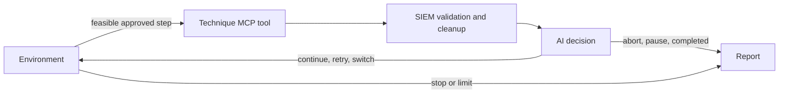

<p align="center">
<h1 align="center">PurpleStrike</h1>
<p align="center"><strong>AI-Driven Breach & Attack Simulation for SIEM Detection Validation</strong></p>
</p>

---

## What is PurpleStrike?

PurpleStrike is an open-source, AI-driven Breach and Attack Simulation (BAS) platform that autonomously executes MITRE ATT&CK techniques against on-premises enterprise environments and validates whether your SIEM detects them. It answers the question:

> **"If an attacker executed technique X right now, would our SIEM alert us?"**

## Key Features

- **Autonomous AI Agent** — Plans and executes approved techniques through MCP, using LangGraph and per-step detection feedback (OpenAI, DeepSeek, Anthropic, Ollama, vLLM)
- **Pre-built Playbooks** — Run defined attack scenarios without AI planning
- **Hybrid Detection Validation** — Deterministic rule mapping + LLM-powered alert correlation for accurate detection checks
- **Financial Risk Quantification** — FAIR-inspired model translates detection gaps into dollar-value Annualized Loss Expectancy (ALE)
- **Actionable Remediation** — SIEM-specific Wazuh custom rule/decoder XML + generic detection guidance per gap
- **Plugin Architecture** — Extensible to any SIEM, any attack framework, any LLM provider
- **Safety Controls** — Plan-once-approval model, built-in safety constraints, automatic cleanup

## Supported Environments

- **Target:** On-premises enterprise (Active Directory, Windows, Linux)
- **SIEM:** Wazuh (v0.1), extensible to Splunk, Elastic, QRadar via plugin
- **Attack Libraries:** Custom Python modules, Atomic Red Team, Caldera, Sliver/Mythic (C2)

---

## Installation

### Prerequisites

- Python 3.11+
- [uv](https://docs.astral.sh/uv/) (recommended) or pip
- A Wazuh manager with API access
- Target test environment (**NOT production**)
- LLM API key (OpenAI or Anthropic) or local Ollama instance

### Install from Source (Development)

```bash
# Clone the repository
git clone https://github.com/your-org/purplestrike.git
cd purplestrike

# Install uv (if not already installed)
curl -LsSf https://astral.sh/uv/install.sh | sh
export PATH="$HOME/.local/bin:$PATH"

# Create virtual environment and install dependencies
uv sync

# Install with dev dependencies (linting, testing, type-checking)
uv sync --extra dev

# Install optional LLM providers
uv sync --extra openai        # OpenAI GPT-4o
uv sync --extra deepseek      # DeepSeek API
uv sync --extra anthropic     # Anthropic Claude
uv sync --extra ollama        # Ollama (local)
uv sync --extra all           # All optional dependencies

# Verify installation
uv run purplestrike version
```

### Install via pip

```bash
pip install purplestrike

# With optional providers
pip install purplestrike[openai]
pip install purplestrike[anthropic]
pip install purplestrike[all]
```

### Configure

```bash
# Interactive configuration wizard
purplestrike config init
```

Set environment variables (or use `.env` — copy from `.env.example`):

```env
# Target credentials
PURPLESTRIKE_TARGET_AD_DOMAIN=corp.local
PURPLESTRIKE_TARGET_USERNAME=attack_user
PURPLESTRIKE_TARGET_PASSWORD=<password>

# Wazuh SIEM
PURPLESTRIKE_WAZUH_API_URL=https://wazuh-manager:55000
PURPLESTRIKE_WAZUH_API_USER=admin
PURPLESTRIKE_WAZUH_API_PASSWORD=<password>
PURPLESTRIKE_WAZUH_API_TIMEOUT=30
# PurpleStrike logs into the Wazuh Dashboard and obtains a Wazuh API JWT from it
PURPLESTRIKE_WAZUH_DASHBOARD_URL=https://wazuh-dashboard
PURPLESTRIKE_WAZUH_DASHBOARD_API_ID=default

# LLM Provider (openai | deepseek | anthropic | ollama | vllm | nvidia)
PURPLESTRIKE_LLM_PROVIDER=openai
PURPLESTRIKE_OPENAI_API_KEY=<key>
PURPLESTRIKE_OPENAI_MODEL=gpt-4o
PURPLESTRIKE_DEEPSEEK_API_KEY=<key>
PURPLESTRIKE_DEEPSEEK_MODEL=deepseek-chat
```

Validate your configuration:

```bash
purplestrike config validate
purplestrike config show
```

---

## Agentless Windows connections

PurpleStrike supports `winrm`, `winrm_nonadmin`, Windows `ssh`, and `wmi`.
The default `auto` preserves the existing selection: Windows uses `winrm`, Linux
uses `ssh`. Selecting a transport never changes the target's operating system,
silently falls back to another transport, or elevates the account.

| Mode | Target requirements | Test account | Controller requirements | Use when |
|---|---|---|---|---|
| `winrm` | WinRM/WinRS; TCP 5985 or configured HTTPS 5986 | Existing authorized account; typically local admin for elevated scenarios | Python + bundled pywinrm | Existing admin test setup, server administration, elevated procedures |
| `winrm_nonadmin` | WinRM/WinRS with deliberately delegated shell access | Standard local/domain account **outside** local Administrators | Same as WinRM | Testing what an ordinary user can execute without pre-granting admin rights |
| `ssh` on Windows | OpenSSH Server, allowed account, TCP 22 or configured port | Standard user or administrator; password or SSH key | `uv sync --extra ssh` | SSH is already approved/deployed, or a general standard-user shell is preferred |
| `wmi` | WMI over DCOM: TCP 135 and negotiated RPC ports; SMB TCP 445 for staging/output | Admin, or delegated WMI/DCOM user with access to a dedicated SMB share | **Windows controller with Windows PowerShell 5.1** | Testing execution through WMI; exercising the DCOM access path independently of WinRM |
| `ssh` on Linux | OpenSSH server and permitted login | Ordinary user; separate permissions for privileged commands | `uv sync --extra ssh` | Normal Linux agentless testing |

All modes run with the selected account's effective permissions. Discovery,
ordinary process execution, and user-owned resources can be tested as a standard
user. Service creation, protected process access, and machine-wide modifications
may require additional privileges. A transport connection does not grant those
privileges. Administrative provisioning is separate from the test account.

For your existing environment, start with `winrm_nonadmin` for procedures that
only need user rights and retain `winrm` for tests that genuinely require an
elevated token. Prefer Windows SSH when it is already part of the managed endpoint
baseline. WMI/DCOM is useful when its execution path is itself relevant to the
test, but requires more network and permission setup than either shell transport.
Delegating remote shell access is an explicit test prerequisite: ordinary users
in an enterprise do not automatically have it. These modes model execution with
an authorized account; they do not reproduce an initial compromise or an
interactive user's desktop session.

WMI uses native .NET `System.Management` over DCOM and
`Win32_Process.Create`; it does **not** execute through WinRM. WMI process creation
does not return stdout or the child exit code, so this backend stages the script
and completion/output files in an explicitly configured SMB share. This is a
WMI/DCOM + SMB mode, not a DCOM-only output channel. No service or persistent agent
is installed by the backend. Its temporary scripts and extra process ancestry
are part of the transport's observable telemetry.

### Selecting a connection and credentials

Set these in `.env` (the CLI loads it) or use the corresponding `connection`
settings in YAML. No existing WinRM setting needs to change to retain `auto`.

```dotenv
PURPLESTRIKE_CONNECTION_METHOD=winrm_nonadmin
PURPLESTRIKE_CONNECT_TIMEOUT=15

# Existing/common credentials remain available for winrm and other modes.
PURPLESTRIKE_TARGET_AD_DOMAIN=CORP
PURPLESTRIKE_TARGET_USERNAME=existing_test_admin
PURPLESTRIKE_TARGET_PASSWORD=<existing-secret>

# Use a machine-qualified name for a local standard user.
PURPLESTRIKE_WINRM_NONADMIN_USERNAME=WORKSTATION\ps_test
PURPLESTRIKE_WINRM_NONADMIN_PASSWORD=<standard-user-secret>
PURPLESTRIKE_WINRM_NONADMIN_DOMAIN=WORKSTATION
```

`winrm_nonadmin`, `ssh`, and `wmi` accept their own credentials through
`PURPLESTRIKE_WINRM_NONADMIN_*`, `PURPLESTRIKE_SSH_*`, and `PURPLESTRIKE_WMI_*`,
where `*` is `USERNAME`, `PASSWORD`, or `DOMAIN`. Without a mode-specific username,
common target credentials are used. If a mode-specific username is supplied,
its password must also be supplied, or SSH key authentication configured; the
common administrator password is not reused for that different username.

Per-host `connection_method` overrides the global selection:

```yaml
connection:
  method: winrm
  ssh_port: 22
  ssh_known_hosts: ./known_hosts
target_groups:
  lab:
    name: lab
    hosts:
      - hostname: workstation.corp.example
        ip: 192.0.2.10
        os: windows
        connection_method: ssh
```

The same host field is accepted in `PURPLESTRIKE_TARGET_GROUPS` JSON. Explicit
`connections check --method ...` overrides selection for that check only.
Mode-specific credentials and connection settings currently apply across hosts;
only the transport selection is overridden per host. Use separate configurations
for hosts that need different accounts or WMI staging paths.

| Environment setting | YAML field under `connection` | Default |
|---|---|---|
| `PURPLESTRIKE_CONNECTION_METHOD` | `method` | `auto` |
| `PURPLESTRIKE_CONNECT_TIMEOUT` | `connect_timeout` | `15` seconds |
| `PURPLESTRIKE_WINRM_ENDPOINT` | `winrm_endpoint` | pywinrm HTTP endpoint for target |
| `PURPLESTRIKE_WINRM_CERT_VALIDATION` | `winrm_cert_validation` | `ignore` (existing lab behavior) |
| `PURPLESTRIKE_SSH_PORT` | `ssh_port` | `22` |
| `PURPLESTRIKE_SSH_KNOWN_HOSTS` | `ssh_known_hosts` | normal OpenSSH known-hosts files |
| `PURPLESTRIKE_SSH_CLIENT_KEYS` | `ssh_client_keys` | `[]` (normal key/agent discovery) |
| `PURPLESTRIKE_WMI_SHARE` | `wmi_share` | `ADMIN$` |
| `PURPLESTRIKE_WMI_SHARE_PATH` | `wmi_share_path` | `Temp` |
| `PURPLESTRIKE_WMI_REMOTE_PATH` | `wmi_remote_path` | `C:\Windows\Temp` |

The connection timeout bounds SSH connection/login and WMI connection operations.
WinRM uses it for HTTP timeouts (with an operation/read-timeout margin) and may
retry shell-opening connection failures up to three times. Command execution has
its own timeout; it is not a hard total wall-clock bound including connection,
output collection, and cleanup. A submitted command is never automatically rerun.

### Delegated non-admin WinRM: target setup

Run provisioning in **elevated Windows PowerShell on the target**. Use a dedicated
standard account; do not add it to Administrators. For a local lab account:

```powershell
$credential = Get-Credential -UserName 'ps_test' -Message 'Password for the new local test user'
New-LocalUser -Name $credential.UserName -Password $credential.Password `
    -Description 'PurpleStrike standard test user'
$account = "$env:COMPUTERNAME\$($credential.UserName)"
Add-LocalGroupMember -SID 'S-1-5-32-545' -Member $account # Users
Add-LocalGroupMember -SID 'S-1-5-32-580' -Member $account # Remote Management Users
Enable-PSRemoting -Force
```

PurpleStrike uses **WinRS through pywinrm**, not a named PSRP PowerShell session
configuration. Check/delegate WinRM resource access; changing only the
`Microsoft.PowerShell` endpoint ACL is insufficient. The following preserves
existing WinRM permissions and grants this account Generic Read + Execute:

```powershell
$sid = (New-Object Security.Principal.NTAccount($account)).Translate(
    [Security.Principal.SecurityIdentifier])
$original = (Get-Item WSMan:\localhost\Service\RootSDDL).Value
$original | Set-Content -LiteralPath '.\winrm-root-sddl-before.txt'
$descriptor = New-Object Security.AccessControl.CommonSecurityDescriptor($false, $false, $original)
$descriptor.DiscretionaryAcl.AddAccess(
    [Security.AccessControl.AccessControlType]::Allow, $sid, -1610612736,
    [Security.AccessControl.InheritanceFlags]::None,
    [Security.AccessControl.PropagationFlags]::None)
Set-Item WSMan:\localhost\Service\RootSDDL -Value $descriptor.GetSddlForm('All') -Force
```

Keep firewall access scoped to the controller. Enterprise endpoint ACLs, logon
rights, and deny policies can still prohibit access. This standard-user setup does
not require disabling UAC or changing `LocalAccountTokenFilterPolicy`.

The `winrm_nonadmin` backend sets the **WinRS** `noprofile` option before opening
the shell and rejects a token containing the Administrators SID, including a
deny-only membership. PowerShell's `-NoProfile` alone is a different setting.
Windows user-profile/HKCU behavior can therefore differ from an interactive
desktop session; validate user-profile-dependent procedures separately.

Domain deployments should use their established Kerberos/hostname configuration.
`PURPLESTRIKE_WINRM_TRANSPORT` still selects pywinrm authentication. An optional
`PURPLESTRIKE_WINRM_ENDPOINT=https://{host}:5986/wsman` selects HTTPS and supports a
per-target `{host}` substitution. Use `PURPLESTRIKE_WINRM_CERT_VALIDATION=validate`
with trusted server certificates; the existing lab default is `ignore`.

### Windows SSH: target setup

In **elevated PowerShell on the target**, install and start OpenSSH Server:

```powershell
Add-WindowsCapability -Online -Name OpenSSH.Server~~~~0.0.1.0
Set-Service sshd -StartupType Automatic
Start-Service sshd
# Substitute the actual controller address. Review any broader existing SSH rule.
New-NetFirewallRule -Name PurpleStrike-SSH -DisplayName 'PurpleStrike SSH' `
    -Direction Inbound -Action Allow -Protocol TCP -LocalPort 22 `
    -RemoteAddress 192.0.2.20
```

Feature installation can fail through a remote WinRM session even when its account
is an administrator. Run that provisioning step locally on the target or through
the enterprise software deployment mechanism. Offline/WSUS-managed devices may
require the matching Windows Features on Demand source. Do not interpret an
installation failure as an SSH authentication failure.

Permit the test account in `%ProgramData%\ssh\sshd_config` according to your
existing policy. `AllowUsers`/`AllowGroups` are optional restrictions: if used, they
must include the account and must preserve existing administrative access. For a
local account, an example entry is `AllowUsers ps_test`. Restart `sshd` after changes.
Keep the existing default shell: PurpleStrike works with either CMD or PowerShell.

```dotenv
PURPLESTRIKE_CONNECTION_METHOD=ssh
PURPLESTRIKE_SSH_USERNAME=WORKSTATION\ps_test
PURPLESTRIKE_SSH_PASSWORD=<standard-user-secret>
PURPLESTRIKE_SSH_PORT=22
PURPLESTRIKE_SSH_KNOWN_HOSTS=C:\path\to\verified_known_hosts
# Optional instead of a password; JSON array of controller-side private key paths:
PURPLESTRIKE_SSH_CLIENT_KEYS=[]
```

For standard-user public-key authentication, install the public key in the target
user's `.ssh\authorized_keys`; administrators use the separate file configured by
OpenSSH. Verify the server host key against the target's
`%ProgramData%\ssh\ssh_host_ed25519_key.pub` through a trusted channel before adding
it to `known_hosts`. Empty `SSH_KNOWN_HOSTS` uses the standard OpenSSH known-hosts
locations. Explicit `none` disables verification for an isolated lab only; host-key
verification is now enabled by default for both Windows and Linux SSH.

Windows scripts are sent through stdin to a small encoded bootstrap, preserving
Unicode, quoting, and large scripts without changing sshd's default shell. SSH
requests termination on timeout; server support determines whether descendants
also terminate. An interactive desktop session is not created.

### WMI over DCOM: target setup

1. Ensure the Windows Management Instrumentation (`Winmgmt`) and Server
   (`LanmanServer`) services are running.
2. Allow TCP 135 (RPC endpoint mapper), the negotiated WMI RPC ports (normally
   dynamic), and TCP 445 (SMB) **from the controller**. Use the Windows WMI firewall
   rules or a service-scoped RPC rule; opening port 135 alone is insufficient.
3. For a standard account, add it to **Distributed COM Users**. In `dcomcnfg`,
   verify effective Remote Access, Remote Launch, and Remote Activation permissions
   in the machine limits and applicable defaults. Hardened domain policy may
   override local group delegation; do not replace the machine-wide ACL wholesale.
4. In `wmimgmt.msc`, open **WMI Control (Local) > Properties > Security >
   Root > CIMV2 > Security**. Grant the account **Enable Account**, **Execute
   Methods**, and **Remote Enable** on this namespace. Read/query access alone does
   not authorize process creation.
5. Provide a dedicated folder/share with NTFS Modify and SMB Change for this
   account. Use the share/local-path pair below so output collection does not need
   `ADMIN$` access:

```powershell
$account = "$env:COMPUTERNAME\ps_test"
$path = 'C:\ProgramData\PurpleStrike\Transport'
New-Item -ItemType Directory -Path $path -Force
icacls.exe $path /grant "${account}:(OI)(CI)M"
New-SmbShare -Name 'PurpleStrikeTransport$' -Path $path -ChangeAccess $account
Add-LocalGroupMember -SID 'S-1-5-32-562' -Member $account
```

```dotenv
PURPLESTRIKE_CONNECTION_METHOD=wmi
PURPLESTRIKE_WMI_USERNAME=WORKSTATION\ps_test
PURPLESTRIKE_WMI_PASSWORD=<standard-user-secret>
PURPLESTRIKE_WMI_DOMAIN=WORKSTATION
PURPLESTRIKE_WMI_SHARE=PurpleStrikeTransport$
PURPLESTRIKE_WMI_SHARE_PATH=.
PURPLESTRIKE_WMI_REMOTE_PATH=C:\ProgramData\PurpleStrike\Transport
```

The default admin pair is `ADMIN$`, `Temp`, `C:\Windows\Temp`. The configured
share subdirectory and absolute target path must refer to the **same directory**.
WMI mode currently requires password credentials and a Windows controller; SSH and
WinRM remain available from other supported controller platforms. No Impacket
installation is needed.
The controller runs a temporary, static Windows PowerShell worker file; its
execution policy/application-control policy must permit that trusted script.
Credentials are passed over stdin, not written into the file or process arguments.
The backend does not change execution policy. Enterprise signing or application
control can require an approved deployment of the worker. Target commands remain
subject to application control and the account's effective privileges.

Each command creates an unpredictable `purplestrike_<uuid>` subdirectory. A target
wrapper captures stdout, stderr, and the actual child exit code, enforces the child
timeout, then publishes a completion record. Normal completion removes only this
job's files and empty directory. A lost connection or local worker timeout can
leave artifacts and an unknown remote result; the error identifies the owned
directory. Inspect that exact directory and process state before cleanup or retry.
Submitted commands are never automatically retried. WMI child timeouts request
termination of the owned process tree; a controller timeout does not prove that
remote execution stopped.

### Reusable target setup and connection validation

For a dedicated lab, [scripts/setup_windows_transports.ps1](scripts/setup_windows_transports.ps1)
combines standard-user creation, group membership, WinRM delegation, CIMV2 method
permissions, a dedicated SMB share, and controller-scoped firewall rules. It
refuses to modify an unrelated existing account. Run it **on the target** as admin:

```powershell
$credential = Get-Credential -UserName 'ps_test'
.\scripts\setup_windows_transports.ps1 -TestCredential $credential `
    -ControllerAddress '192.0.2.20' -InstallSsh
```

Omit `-InstallSsh` if OpenSSH is already managed by your enterprise. The script
prints the resulting account/share settings and saves an ACL snapshot under
`%ProgramData%\PurpleStrike`. Setup changes remain in place for subsequent tests;
they are not automatically undone by the connection checker. Revoke the dedicated
account's WinRM/WMI ACEs, remove its account/share access and the named
`PurpleStrike-Test-*` firewall rules when retiring the lab. Do not restore an old
whole-machine ACL snapshot over unrelated changes made since provisioning.
The helper refuses pre-existing transport folders/shares without its ownership
record and does not broaden machine-wide DCOM permissions. An existing broad
firewall rule can still allow other sources; adding a scoped rule does not narrow
that existing rule. Review the effective firewall and domain policies separately.

From the controller's `code` directory:

```powershell
uv sync --extra ssh --extra dev --inexact
uv run --inexact purplestrike connections check --method all `
    --output results/connections.json
# Check one configured host/mode without changing normal run configuration:
uv run --inexact purplestrike connections check --target 192.0.2.10 --method winrm_nonadmin
```

The checker uses only configured hosts. It tests connection and effective
identity, long/Unicode PowerShell input, a uniquely named temporary file with
cleanup, explicit and native exit codes, and a bounded sleep timeout. It does not
run ATT&CK techniques or query the SIEM. JSON reports contain no passwords and the
command exits nonzero if any check fails. A successful connection check establishes
transport behavior, not permission to execute every technique or detection coverage.

| Failure | What to check |
|---|---|
| Non-admin WinRM access denied | Account/group SID, WinRM resource ACL and deny policies; use `winrm_nonadmin` for WinRS no-profile behavior |
| Non-admin mode rejects account | Its token contains local Administrators membership; use an actual standard user |
| SSH host key rejected | Verify/pin the actual host key; do not silently accept an unexpected replacement |
| SSH connection refused | OpenSSH Server installation/service, configured port, firewall |
| WMI RPC server unavailable | TCP 135 **and** negotiated dynamic RPC connectivity; WMI service and DCOM policy |
| WMI access denied | DCOM permissions, CIMV2 Execute Methods/Remote Enable, account logon restrictions |
| SMB access denied / error 1219 | Share + NTFS rights; conflicting existing SMB credentials to the same server |
| WMI connects but command fails | Matching share/local directory, script/application-control policy, child stderr/exit code |
| A privileged technique fails through every mode | Actual technique prerequisites and token privileges; changing transports does not grant elevation |

References: [WinRS non-admin/profile behavior](https://learn.microsoft.com/en-us/windows-server/administration/windows-commands/winrs),
[OpenSSH server setup](https://learn.microsoft.com/en-us/windows-server/administration/openssh/openssh_install_firstuse),
[OpenSSH access configuration](https://learn.microsoft.com/en-us/windows-server/administration/openssh/openssh-server-configuration),
[WMI remote process permissions](https://learn.microsoft.com/en-us/windows/win32/wmisdk/creating-processes-remotely),
[WMI/DCOM security](https://learn.microsoft.com/en-us/windows/win32/wmisdk/securing-a-remote-wmi-connection),
[PowerShell execution policy](https://learn.microsoft.com/en-us/powershell/module/microsoft.powershell.core/about/about_execution_policies?view=powershell-5.1),
[pywinrm transport implementation](https://github.com/diyan/pywinrm/blob/master/winrm/transport.py).

### Validation against the configured lab host (2026-10-06)

Local verification: **275 tests passed**, including real Windows PowerShell child
process checks for Unicode, explicit/native failures and WMI timeout termination.
The changed Python modules pass Ruff lint, and the target setup script passes the
Windows PowerShell parser. These checks do not substitute for live SSH/DCOM testing.

Target: `10.10.1.107` (`DESKTOP-54IL91M`). Live checks used the existing `.env`
admin account and the authorized new standard account
`DESKTOP-54IL91M\ps_conn_4abea9`. Its generated credentials are stored only in the
ignored local `.env` under the non-admin WinRM, SSH, and WMI credential settings.
The common admin credentials and default `auto` selection remain unchanged.

| Mode | Observed live result |
|---|---|
| Admin WinRM | Connected; confirmed administrator identity, long/Unicode output and explicit exit code. Initial native-exit and timeout checks exposed defects that were corrected; final live rerun blocked by loss of connectivity. |
| Delegated non-admin WinRM | Connected as the new local account; confirmed `administrator=false`, long/Unicode output and explicit exit code. Final live rerun blocked by loss of connectivity. |
| Windows SSH | Live connection attempted but not validated. OpenSSH Server was absent; feature installation through WinRM returned Access Denied. Target-local installation and host-key pinning remain required. |
| WMI/DCOM + SMB | Namespace/share delegation completed. Live connection attempted but not validated; the native worker reports RPC server unavailable. |

The target subsequently stopped responding to WinRM, SSH, RPC and SMB probes.
The final all-mode attempt is saved locally in
`results/connections_20261006_final.json`; it records failures, not successful
end-to-end validation. Rerun `connections check --method all` once the target is
reachable and OpenSSH is installed. No ATT&CK attack procedures were run during
these connection checks.

Provisioning already performed on this host: a standard local account, membership
in Users/Remote Management Users/Distributed COM Users, a WinRM SID-specific
Read/Execute ACE, CIMV2 Enable/Execute Methods/Remote Enable rights, the dedicated
`PurpleStrikeTransport$` share at `C:\ProgramData\PurpleStrike\Transport`, and
`PurpleStrike-Test-*` firewall rules scoped to the observed controller address
`192.169.50.10`. The account was **not** added to Administrators. The provisioning
record is `results/connection_setup_20261006.json`. The target ACL snapshot is
`C:\ProgramData\PurpleStrike\transport-setup-S-1-5-21-3078035323-2162789189-220950864-1015.json`.
This first provisioning run preceded the helper's ownership-marker safeguard;
review that existing setup manually before rerunning the helper on this host.
The snapshot was taken during iterative setup and must not be treated as a full
pre-change rollback image. Revoke only this test account's additions when retiring it.

## Existing admin WinRM setup (workgroup lab, IP-based NTLM)

This is the existing elevated-account recipe. Use the delegated setup above for
standard-user tests; do not apply the local-admin UAC setting to non-admin accounts.

This guide documents a working WinRM configuration for Windows 10/11 targets using:

- WinRM over HTTP (5985)
- NTLM authentication (Negotiate)
- IP-based targeting (no DNS required)
- TrustedHosts for native Windows WSMan clients using HTTP/IP targeting
- No Kerberos, no CredSSP, no domain required

---

### Target Machine Setup (Windows 10/11)

Run all commands in **elevated PowerShell** on the target.

#### 1. Enable WinRM

```powershell
Enable-PSRemoting -Force
```

Or:

```powershell
winrm quickconfig -q
```

#### 2. Verify WinRM listener

```powershell
winrm enumerate winrm/config/listener
```

Expected output:

```
Transport = HTTP
Port = 5985
Address = *
```

If missing, re-run `winrm quickconfig`.

#### 3. Enable NTLM authentication

```powershell
winrm set winrm/config/service/auth '@{Negotiate="true"}'
```

#### 4. Allow local account remote access (IMPORTANT for workgroup setups)

```powershell
reg add HKLM\SOFTWARE\Microsoft\Windows\CurrentVersion\Policies\System /v LocalAccountTokenFilterPolicy /t REG_DWORD /d 1 /f
```

#### 5. Ensure user is in Administrators group

```powershell
net localgroup administrators <username> /add
```

#### 6. Restart WinRM

```powershell
Restart-Service WinRM
```

---

### Client Machine Setup

Run in **elevated PowerShell** on the PurpleStrike client machine.

#### 1. Configure TrustedHosts (native Windows WSMan clients)

This setting applies to commands such as `Enter-PSSession` below. PurpleStrike's
Python/pywinrm client does not use the Windows client's TrustedHosts list. Keep
Kerberos enabled in domain environments; NTLM testing does not require disabling it.

```powershell
Set-Item WSMan:\localhost\Client\TrustedHosts -Value "10.10.1.107" -Force
```

Verify:

```powershell
Get-Item WSMan:\localhost\Client\TrustedHosts
```

(Optional) Allow all hosts (lab only):

```powershell
Set-Item WSMan:\localhost\Client\TrustedHosts -Value "*" -Force
```

---

### Connectivity Tests

#### 1. Test WinRM service

```powershell
Test-WSMan 10.10.1.107
```

Expected: WSMan identity response.

#### 2. Test TCP connectivity

```powershell
Test-NetConnection 10.10.1.107 -Port 5985
```

Expected: `TcpTestSucceeded : True`

---

### Remote PowerShell Usage

Start interactive session:

```powershell
Enter-PSSession -ComputerName 10.10.1.107 -Authentication Negotiate -Credential Administrator
```

Run remote command:

```powershell
Invoke-Command -ComputerName 10.10.1.107 -Authentication Negotiate -Credential Administrator -ScriptBlock {
    whoami
}
```

---

### Python (pywinrm) Usage

```python
import winrm

session = winrm.Session(
    "10.10.1.107",
    auth=("Administrator", "password"),
    transport="ntlm",
)

result = session.run_ps("whoami")
print(result.status_code)
print(result.std_out.decode())
```

---

### Common Issues & Fixes

| Issue | Fix |
|---|---|
| **"Access is denied"** | Run on target: `reg add HKLM\SOFTWARE\Microsoft\Windows\CurrentVersion\Policies\System /v LocalAccountTokenFilterPolicy /t REG_DWORD /d 1 /f`. Ensure user is in Administrators group. |
| **WinRM connection fails** | Check `winrm quickconfig` on target and `Test-NetConnection <ip> -Port 5985` from client. |
| **TrustedHosts error** | Run on client: `Set-Item WSMan:\localhost\Client\TrustedHosts -Value "<target-ip>" -Force` |

---

## Quick Start

```bash
# AI agent mode — agent plans and chains attacks
purplestrike run --mode agent --target-group production_win

# Playbook mode — run a pre-defined scenario
purplestrike run --mode playbook --playbook ad_credential_harvesting \
    --target-group production_win

# Dry-run — generate plan only, no execution
purplestrike plan --mode agent --target-group production_win

# Check what your SIEM covers
purplestrike siem rules --technique T1558.003
```

---

## CLI Reference

### Top-level Commands

| Command | Description |
|---|---|
| `purplestrike version` | Show version information |
| `purplestrike run` | Execute an attack simulation |
| `purplestrike plan` | Generate an attack plan without executing (dry-run) |
| `purplestrike config` | Manage configuration (init, show, set-value, validate) |
| `purplestrike techniques` | List and inspect MITRE ATT&CK techniques |
| `purplestrike siem` | SIEM connector management (test, rules) |
| `purplestrike playbooks` | List, show, and validate attack playbooks |

### `purplestrike run`

Execute an attack simulation against a target group.

```bash
purplestrike run \
    --target-group production_win \   # (required) target group from config
    --mode agent \                    # agent | playbook
    --playbook ad_credential_harvesting \  # playbook name (for playbook mode)
    --tactics TA0001,TA0002 \         # filter by MITRE tactic IDs
    --techniques T1558.003,T1059.001 \# filter by technique IDs
    --max-steps 20 \                  # max attack steps
    --detection-check-delay 30 \      # seconds to wait before querying SIEM
    --output-dir ./results \          # report output directory
    --format both \                   # json | csv | both
    --llm-provider openai \           # override LLM provider
    --skip-cleanup \                  # skip cleanup after execution
    --dry-run                         # generate plan only, no execution
```

### `purplestrike plan`

Generate an attack plan without executing it.

```bash
purplestrike plan \
    --target-group production_win \   # (required) target group from config
    --mode agent \                    # agent | playbook
    --playbook path/to/playbook.yaml\ # path to playbook YAML
    --tactics TA0001,TA0002 \         # filter by MITRE tactic IDs
    --output plan.yaml                # save plan to YAML file
```

### `purplestrike techniques`

List and inspect the 61 built-in scenarios (60 unique ATT&CK technique IDs).

```bash
# List all techniques
purplestrike techniques list

# Filter by tactic
purplestrike techniques list --tactic TA0006

# Show technique details, parameters, and detection mappings
purplestrike techniques show T1558.003
```

### `purplestrike siem`

Manage SIEM connectivity and inspect rules.

```bash
# Test SIEM connectivity
purplestrike siem test

# List all SIEM rules with MITRE mappings
purplestrike siem rules

# List rules for a specific technique
purplestrike siem rules --technique T1543.003
```

### `purplestrike config`

Manage PurpleStrike configuration.

```bash
# Interactive configuration wizard
purplestrike config init

# Display current configuration
purplestrike config show

# Set a configuration value (dot-notation)
purplestrike config set-value siem.api_url https://wazuh:55000
purplestrike config set-value siem.api_user admin
purplestrike config set-value siem.api_password
purplestrike config set-value siem.dashboard_url https://wazuh-dashboard

# Validate configuration
purplestrike config validate
```

### `purplestrike playbooks`

List, inspect, and validate attack playbooks.

```bash
# List available playbooks
purplestrike playbooks list

# Show playbook details and steps
purplestrike playbooks show ad_credential_harvesting

# Validate a playbook YAML file
purplestrike playbooks validate path/to/playbook.yaml
```

---

## How It Works

```
┌──────────────┐    ┌────────────────┐    ┌─────────────────┐
│ LangGraph    │───▶│ MCP Servers    │───▶│ Target Systems  │
│ Agent /      │    │ (Technique     │    │ (AD, Win, Linux)│
│ Fixed Plan   │    │  Plugins)      │    │                 │
└──────────────┘    └────────────────┘    └────────┬────────┘
                                                   │
                                                   ▼
                         ┌────────────────────────────────────────┐
                         │      Detection Validation Engine      │
                         │  ┌──────────────┐ ┌───────────────┐   │
                         │  │ Rule-Based   │ │ AI Alert      │   │
                         │  │ Mapper       │ │ Correlator    │   │
                         │  └──────────────┘ └───────────────┘   │
                         │       SIEM Connector (Wazuh)          │
                         └──────────────────┬─────────────────────┘
                                            │
                                            ▼
                         ┌────────────────────────────────────────┐
                         │  Risk Quantifier + Remediation Engine  │
                         │       JSON / CSV Report Output         │
                         └────────────────────────────────────────┘
```

1. **Plan** — AI agent or playbook generates an attack plan (technique chain)
2. **Approve** — Operator reviews and approves the plan before execution
3. **Execute** — Attack techniques are executed against target systems
4. **Validate** — After each step + after full campaign, query Wazuh for alerts
5. **Quantify** — Calculate financial risk (ALE) for undetected techniques
6. **Remediate** — Generate Wazuh custom rules + generic detection guidance for gaps
7. **Report** — Output JSON + CSV with full results, risk scores, and remediation

---

## MITRE ATT&CK Alignment and Coverage

The built-in catalog is pinned to **Enterprise ATT&CK v19.2**. It stores each
technique object's current version, official tactics, ATT&CK URL, Detection
Strategy, Analytics, and required log sources. ATT&CK v19 renamed `TA0005` to
**Stealth** and introduced **Defense Impairment (`TA0112`)**; PurpleStrike uses
those current tactic names while accepting the old `DEFENSE_EVASION` enum alias
for saved-plan compatibility.

| Version | Tactics | Techniques |
|---|---|---|
| v0.1 (MVP) | Initial Access, Execution, Persistence, Privilege Escalation, Credential Access | 42 scenarios / 41 ATT&CK IDs |
| Current | + ATT&CK v19 Stealth and Defense Impairment additions | 61 scenarios / 60 ATT&CK IDs |
| v0.2 | + Lateral Movement | ~71 |
| v0.3 | + Collection, Exfiltration, C2 | ~87 |
| v1.0 | Broader on-prem procedure coverage | ~132 |

### Current Technique Breakdown — 61 Scenarios

| Tactic | ID | Techniques |
|---|---|---|
| Initial Access (TA0001) | T1190, T1133, T1078, T1078.001–003, T1566.001–002 | 8 |
| Execution (TA0002) | T1059.001, T1059.003–005, T1047, T1569.002–003, T1204.001–002, T1053.005 | 10 |
| Persistence (TA0003) | T1053.005p, T1547.001, T1547.004, T1546.001, T1546.003, T1546.008, T1136.001–002 | 8 |
| Privilege Escalation (TA0004) | T1548.001–002, T1068, T1543.003, T1134.001–002, T1484.001, T1055.001 | 8 |
| Credential Access (TA0006) | T1558.003–004, T1110.001–003, T1552.001–002, T1003.001–002 | 8 |
| Stealth (TA0005) | T1027.018, T1684, T1684.001–002 | 4 |
| Defense Impairment (TA0112) | T1685, T1685.001–006, T1686, T1686.001–003, T1687–T1690 | 15 |

The v19.2 audit also identified four new pre-compromise objects—T1682 and
T1683/T1683.001/T1683.002—in Reconnaissance and Resource Development. They are
not registered as endpoint BAS tests: querying a public AI service or merely
generating content would not exercise a target-side control, and an artifact
would not establish ATT&CK coverage. They require a future campaign/service
testing workflow with authorized external accounts and delivery telemetry.

Every scenario declares one evidence mode:

| Mode | Meaning | ATT&CK coverage claim |
|---|---|---|
| `procedure` | The ATT&CK-aligned behavior and its success criterion completed | Eligible for validated/gap coverage |
| `telemetry` | A safe subset generated the core detection telemetry | Partial evidence only |
| `artifact` | A representative file or configuration marker was created | Not assessed |
| `prerequisite` | The runner checked readiness or enumerated candidates | Not assessed |

Detection status describes whether the SIEM alerted on the activity that actually
ran. `coverage_status` separately reports `validated`, `gap`, `partial`, or
`not_assessed`. The report's detection-rate denominator contains only successful
`procedure` runs with a conclusive SIEM result. Probe-only, artifact-only, failed,
and inconclusive runs therefore cannot inflate ATT&CK coverage. A single atomic
procedure validates that procedure and analytic path; it never means every possible
implementation of the ATT&CK technique is covered.

The internal persistence scenario `T1053.005p` maps to ATT&CK `T1053.005` for
detection. Linux service execution uses `T1569.003`; Kerberoasting and AS-REP
Roasting use `T1558.003` and `T1558.004`.

---

## Architecture

PurpleStrike uses a **plugin-based modular architecture** with four plugin types:

| Plugin | Purpose | Built-in Implementations |
|---|---|---|
| **Attack Executor** | Execute techniques on target systems | Custom Python (SSH, WinRM, delegated WinRM, WMI/DCOM + SMB) |
| **SIEM Connector** | Query alerts and rules from SIEM | Wazuh |
| **LLM Provider** | Power agent reasoning and alert correlation | OpenAI, DeepSeek, Anthropic, Ollama, vLLM |
| **Report Formatter** | Generate output reports | JSON, CSV |

All plugin types follow Python `Protocol` interfaces (runtime-checkable) and are loaded by the `PluginLoader` from built-in packages or user plugin directories (`~/.purplestrike/plugins/`).

---

## Project Structure

```
purplestrike/
├── src/purplestrike/
│   ├── __init__.py              # Package version
│   ├── cli/                     # CLI commands (Typer + Rich)
│   │   ├── app.py               # Top-level CLI app & command registration
│   │   ├── config.py            # config init / show / set-value / validate
│   │   ├── plan.py              # plan — dry-run attack plan generation
│   │   ├── run.py               # run — execute simulation
│   │   ├── techniques.py        # techniques list / show
│   │   ├── siem.py              # siem test / rules
│   │   └── playbooks.py         # playbooks list / show / validate
│   ├── core/                    # Core orchestration & AI agent
│   │   ├── orchestrator.py      # Top-level simulation coordinator
│   │   ├── agent_loop.py        # LLM-driven attack plan generation
│   │   └── plan.py              # AttackPlan & AttackPlanStep models
│   ├── models/                  # Pydantic data models
│   │   ├── config.py            # PurpleStrikeConfig, TargetGroup, RiskParameters
│   │   ├── techniques.py        # Technique, DetectionMapping, TechniqueParameter
│   │   ├── simulation.py        # Simulation, SimulationStep, DetectionResult, RiskResult
│   │   ├── remediation.py       # RemediationEntry, WazuhRemediation, GenericGuidance
│   │   └── report.py            # SimulationReport, SimulationSummary
│   ├── techniques/              # MITRE ATT&CK technique definitions
│   │   ├── registry.py          # TechniqueRegistry with lazy auto-loading
│   │   ├── initial_access/      # 8 techniques (T1190, T1133, T1078.x, T1566.x)
│   │   ├── execution/           # 10 techniques (T1059.x, T1047, T1569.x, T1204.x)
│   │   ├── persistence/         # 8 techniques (T1053.005p, T1547.x, T1546.x, T1136.x)
│   │   ├── privilege_escalation/# 8 techniques (T1548.x, T1068, T1543.003, T1134.x, T1055.001)
│   │   ├── credential_access/   # 8 techniques (T1558.x, T1110.x, T1552.x, T1003.x)
│   │   ├── stealth/             # 4 ATT&CK v19 Stealth techniques
│   │   └── defense_impairment/  # 15 ATT&CK v19 Defense Impairment techniques
│   ├── validation/              # Detection validation engine
│   │   └── engine.py            # Hybrid rule-based mapper + AI alert correlator
│   ├── risk/                    # Financial risk quantification
│   │   └── quantifier.py        # FAIR-inspired ALE calculation
│   ├── remediation/             # Remediation & guidance engine
│   │   └── engine.py            # Wazuh XML rule DB + generic guidance fallback
│   ├── reporting/               # Report storage
│   │   └── store.py             # SQLite simulation store
│   └── plugins/                 # Plugin system
│       ├── protocols.py         # AttackExecutor, SIEMConnector, LLMProvider, ReportFormatter
│       ├── registry.py          # PluginRegistry singleton
│       ├── loader.py            # Builtin + user plugin discovery & loading
│       ├── attack_executors/
│       │   └── custom_python/   # Dynamic module loading executor
│       ├── siem_connectors/
│       │   └── wazuh/           # Wazuh API client (auth, alerts, rules)
│       ├── llm_providers/
│       │   ├── openai_provider.py   # OpenAI with retry logic
│       │   ├── anthropic_provider.py# Anthropic with retry logic
│       │   ├── ollama_provider.py   # Ollama local inference
│       │   └── vllm_provider.py     # vLLM local inference
│       └── report_formatters/
│           ├── json_fmt.py          # JSON report output
│           └── csv_fmt.py           # CSV report output
├── tests/                       # Test suite
├── playbooks/                   # Built-in attack playbooks (YAML)
├── pyproject.toml               # Project config (hatchling, deps, ruff, mypy, pytest)
├── .env.example                 # Environment variable template
├── PRD.md                       # Full Product Requirements Document
├── README.md                    # This file
└── TODO.md                      # Development task tracker
```

---

## Code Documentation

### Core Modules

#### Orchestrator (`core/orchestrator.py`)

The `Orchestrator` is the top-level coordinator for every simulation run. It:

- Generates attack plans via AI agent or playbook parsing
- Displays the plan for operator approval (plan-once-approval safety model)
- Executes each technique and its cleanup exclusively through configured MCP servers
- Validates detection after each step (with configurable delay for SIEM ingestion)
- Calculates financial risk (ALE) for undetected techniques
- Generates remediation guidance (Wazuh rules + generic)
- Outputs reports (JSON + CSV) to the configured directory

```python
from purplestrike.core.orchestrator import Orchestrator
from purplestrike.models.config import PurpleStrikeConfig

config = PurpleStrikeConfig()
orchestrator = Orchestrator(config=config)
report = await orchestrator.execute(
    mode="agent",
    target_group_name="production_win",
    tactics=["TA0006"],
    technique_ids=["T1558.003"],
)
```

#### Agent Loop (`core/agent_loop.py`)

The `AgentLoop` uses an LLM provider to generate realistic, chained attack plans. It:

- Builds a prompt with available techniques, target context, and safety constraints
- Parses the LLM's JSON response into an `AttackPlan`
- Filters out unsafe techniques (`safe_to_execute=True` only)
- Falls back to default technique selection if the LLM fails

#### Agentic execution (`core/execution_graph.py`)

`--mode agent` now executes a LangGraph workflow after plan approval. The graph has
one node per approved technique tool, an environment node, a detection node, and
an AI decision node. Every attempt sends its execution output, errors, evidence,
tool detection metadata, SIEM assessment, cleanup outcome, and recent history to
the configured LLM. Configured secrets are redacted from execution feedback.



The AI can continue to the next pending step, retry the current step with changed
parameters, switch to another pending **approved** step, abort, or pause. A switch
reorders the remaining work; it does not authorize additional techniques or hosts.
For `continue`, a redundant `next_step` is accepted only if it matches the first
pending plan position; `{}` parameters mean no changes. Conflicting transitions
still pause, with the rejected decision retained in the report and log after
secret redaction.
Tool schemas, configured target OS, retry limits, and the total attempt budget are
enforced outside the model. `max_steps` includes retries. Invalid decisions, a
missing LLM, ambiguous tool mappings, and uncertain execution outcomes never fall
back to a local executor. Detection failures remain `unknown` feedback.

`--mode default` and `--mode playbook` use the same MCP graph and fixed sequencing.
`--dry-run` discovers tools and generates a plan without calling technique tools.
Plan approval covers parameter adjustments and reordering within the displayed
scope. Cleanup runs after detection and before the next attempt, so later steps
must not assume that an earlier step's temporary resources still exist.

JSON and CSV reports retain each attempt's original plan position, tool name,
parameters, detection metadata, cleanup error, and AI decision. A paused run stops
dispatching tools and closes its sessions; the JSON report preserves the remaining
positions and parameters for operator review. Automatic cross-process resume is
not implemented; prepare and approve the remaining work as a new run. Existing
executor cleanup ownership remains session-local, including when cleanup is skipped.

#### Execution logging

Every run writes detailed events to the console (stderr, INFO and above) and to
`logs/purplestrike_<timestamp>_<pid>.log` (DEBUG and above). No extra flag is needed.
Files rotate at 10 MB, retaining up to five backups per log file.

- Graph start and finish events include the approved plan, environment, status,
  and remaining steps.
- Each step records its plan position, attempt, target, parameters, and outcome.
- Each MCP call records the server, tool name, complete arguments, response or
  exception, duration, and a shared `call_id`. Cleanup calls are included.
- Detection events include execution and validation timestamps, expected rules, alerts,
  coverage assessment, reasoning, and cleanup outcome.
- AI events record the provider and model, execution feedback, response before
  validation, applied decision, reason, and next step or retry parameters.
  Rejected and malformed decisions are logged to explain pauses. Full planning
  and decision prompts are DEBUG events in the file only.

Execution events carry the simulation ID and, where applicable, the plan position
and attempt so calls and decisions can be traced together. Tool output is not
truncated. Known configured credentials and sensitive fields such as `password`,
`api_key`, and `authorization` are redacted, including later echoes of those
values; unrelated text in tool output is preserved.

#### MCP servers and adding tools

Install dependencies with `uv sync --all-extras`. With `mcp.servers` empty, the
orchestrator launches `python -m purplestrike.mcp.server` over stdio using its own
interpreter. That process wraps the existing executor plugins, keeps their cleanup
state alive throughout the run, and receives the configured hosts and connection
settings. Names include `run_powershell`, `execute_scheduled_task`, and
`probe_default_accounts`; other built-ins use `run_<technique_id>` with dots replaced
by underscores. The server also has a `purplestrike-mcp` entry point.

Configure replacement servers in `~/.purplestrike/config.yaml`:

```yaml
mcp:
  timeout_seconds: 180
  servers:
    lab_tools:
      transport: streamable_http
      url: http://localhost:8000/mcp
    extra_tools:
      transport: stdio
      command: python
      args: [path/to/extra_server.py]
      env: {}
execution:
  max_retries_per_step: 2
  decision_timeout_seconds: 90
```

A nonempty server mapping replaces the bundled server. `headers` is supported for
HTTP authentication. `PURPLESTRIKE_MCP_SERVERS` accepts the server mapping as JSON;
`PURPLESTRIKE_MCP_TIMEOUT` and `PURPLESTRIKE_MAX_RETRIES` override the corresponding
limits. The standalone bundled server accepts `PURPLESTRIKE_MCP_CONFIG` as executor
configuration JSON, or reads the standard `PURPLESTRIKE_*` environment variables
when that JSON is absent. It refuses calls to hosts outside its configuration.

New servers can add tools without changing the graph. Each technique tool must
publish a description explaining its behavior and execution constraints, JSON
input/output schemas, and this MCP tool metadata:

```json
{
  "_meta": {
    "purplestrike": {
      "technique": {
        "technique_id": "T1059.001",
        "name": "PowerShell",
        "tactic": "TA0002",
        "target_os": ["windows"],
        "safe_to_execute": true,
        "emulation_mode": "procedure"
      },
      "cleanup_tool": "run_powershell_cleanup"
    }
  }
}
```

`technique` follows `models/techniques.py:Technique`; include parameter definitions,
detection mappings, validation notes, and an accurate emulation mode. Tools without
this metadata are ignored. Duplicate technique IDs across servers are rejected
instead of choosing a tool silently. A cleanup tool must be listed by the same
server; tools with no persistent effects can supply a no-op cleanup endpoint.

Inputs use `{"target": "configured-host", "parameters": {}, "environment": {}}`.
Results must use MCP `structuredContent` conforming to
`mcp/contracts.py:ToolOutput`: `technique_id`, boolean `success`, output/error text,
execution status and duration, artifacts/evidence, emulation mode, and
`detection_metadata`. The last field contains tool observations; SIEM validation
remains the authoritative detection assessment. Cleanup accepts the same inputs
and returns structured content with `success: true`, or an error. Review the
bundled `mcp/server.py` for a complete wrapper around an executor plugin.

The implementation uses the [LangGraph graph API](https://docs.langchain.com/oss/python/langgraph/graph-api)
and the [MCP Python SDK v1 protocol interfaces](https://github.com/modelcontextprotocol/python-sdk/tree/v1.x).
MCP is constrained to `<2` because the v2 SDK changes these interfaces.

#### Detection Validation Engine (`validation/engine.py`)

Hybrid detection validation with two layers:

1. **Rule-Based Mapper** — Checks if expected SIEM rule IDs appear in alerts (exact match)
2. **AI Alert Correlator** — Uses LLM to analyze alert semantics when rule-based matching fails

Returns `DetectionResult` with activity status (`detected` / `partially_detected` / `not_detected` / `unknown`), confidence, matched rules, ATT&CK coverage status, coverage eligibility, and reasoning.

The validator merges saved-plan rules with current technique mappings and the installed SIEM catalog. Explicit mappings can match even when the alert uses a different MITRE ID, such as Wazuh rule `91815` for PowerShell process discovery. Wazuh searches both manager `timestamp` and Windows `data.win.system.systemTime`, so a manager clock offset does not hide alerts from short steps. Queries retain a two-second margin (`siem.extra.clock_skew_seconds`); the validator then checks the exact Windows event-time window to exclude earlier steps and cleanup. Other events use their alert timestamp. The `detection.query.started` and `detection.query.result` log events show query bounds, alert timestamps, and counts of returned, out-of-window, routine authentication, and candidate events. Empty candidate results explain these counts in the report. AI correlation receives bounded raw-event context with configured credentials redacted. Candidate alerts are retained separately from confirmed matches. Coverage assessment is performed after execution using the scenario's evidence mode, independently of whether the generated activity produced an alert.

Routine Windows authentication events (4624, 4634, 4647, 4672) and Wazuh rules 92657, 60106, 60137, and 67028 are excluded before rule matching and AI correlation, regardless of their MITRE tags or expected-rule mappings. They remain in `DetectionResult.excluded_alerts` for audit. Successful transport authentication alone never confirms technique detection; failed-logon and account-change events remain eligible.

The custom Python executor treats service, scheduled-task, Run-value, and account-creation names as prefixes and allocates a unique suffix for every execution, including saved-plan replays. Allocated names appear in result artifacts and are retained in memory for cleanup. Account names are shortened to the Windows 20-character limit. File associations and task output files also use unique names. Cleanup removes resources owned by the current executor; a restarted process does not claim earlier resources. Fixed system keys retain their conflict checks and backup/restore behavior. Permissions, unavailable prerequisites, interrupted cleanup, and occupied fixed keys can still prevent successful execution.

#### Risk Quantifier (`risk/quantifier.py`)

FAIR-inspired financial risk model:

- **Threat Event Frequency (TEF)** — How often the technique occurs per year (per-technique defaults, configurable)
- **Detection Vulnerability Score** — 0.05 (detected) / 0.5 (partial) / 0.95 (not detected)
- **Loss Magnitude** — Per-tactic dollar impact (e.g., Credential Access = $550k)
- **ALE** = TEF x Vulnerability Score x Loss Magnitude

#### Remediation Engine (`remediation/engine.py`)

For every undetected technique, generates:

- **Wazuh-specific remediation** — Custom Wazuh rule XML (with MITRE tag), log source requirements, and testing instructions. Built-in database covers 6 key techniques (T1558.003, T1558.004, T1003.001, T1003.002, T1110.001, T1110.003)
- **Generic guidance** — Data sources, detection logic, false positive considerations, and MITRE references for all built-in scenarios

#### Simulation Store (`reporting/store.py`)

SQLite-backed persistent storage for simulation results. Schema includes:

- `simulations` — Run metadata, detection summary, total ALE
- `simulation_steps` — Per-step execution and detection results
- `remediations` — Generated remediation entries per simulation

### Plugin System

All plugins implement `Protocol` interfaces defined in `plugins/protocols.py`:

| Protocol | Methods |
|---|---|
| `AttackExecutor` | `setup()`, `execute()`, `cleanup()`, `teardown()` |
| `SIEMConnector` | `setup()`, `query_alerts()`, `get_rule()`, `get_rules_for_technique()`, `teardown()` |
| `LLMProvider` | `setup()`, `complete()`, `complete_structured()`, `teardown()` |
| `ReportFormatter` | `setup()`, `format()`, `teardown()` |

The `PluginLoader` discovers and loads:
- **Built-in plugins** — From `purplestrike.plugins.*` packages
- **User plugins** — From `~/.purplestrike/plugins/` directory

Naming convention: snake_case module name → PascalCase class name + suffix (e.g., `custom_python` → `CustomPythonExecutor`)

### Technique Registry

The `TechniqueRegistry` uses lazy auto-loading (`_ensure_loaded()`) to avoid circular imports at module level. Techniques are defined as `TechniqueDefinition` instances in per-tactic modules and registered on first access.

```python
from purplestrike.techniques.registry import technique_registry

# List all 61 built-in scenarios
all_techniques = technique_registry.list_techniques()

# Get a specific technique
t = technique_registry.get_technique("T1558.003")
print(t.name, t.detection_mappings, t.parameters)
```

### Data Models

All data models use Pydantic v2 with strict validation:

| Module | Key Models |
|---|---|
| `models/config.py` | `PurpleStrikeConfig`, `TargetGroup`, `TargetHost`, `SIEMConfig`, `LLMConfig`, `RiskParameters` |
| `models/techniques.py` | `Technique`, `DetectionMapping`, `TechniqueParameter`, `TacticID` |
| `models/simulation.py` | `Simulation`, `SimulationStep`, `DetectionResult`, `RiskResult`, `SIEMAlert`, `SIEMRule` |
| `models/remediation.py` | `RemediationEntry`, `WazuhRemediation`, `GenericGuidance`, `RemediationConfidence` |
| `models/report.py` | `SimulationReport`, `SimulationSummary` |

---

## Development

### Setup

```bash
# Clone and enter the project
git clone https://github.com/your-org/purplestrike.git
cd purplestrike

# Install uv
curl -LsSf https://astral.sh/uv/install.sh | sh
export PATH="$HOME/.local/bin:$PATH"

# Install all dependencies (including dev)
uv sync --extra dev

# Verify
uv run purplestrike version
```

### Linting & Formatting

```bash
# Run ruff linter
uv run ruff check src/

# Auto-fix safe issues
uv run ruff check --fix src/

# Run ruff formatter
uv run ruff format src/

# Line length: 100 (configured in pyproject.toml)
# Rule set: E, F, I, N, W, UP, B, A, SIM, RUF
```

### Type Checking

```bash
# Run mypy (strict mode)
uv run mypy src/

# Config: python_version = "3.11", strict = true
# Ignored: pywinrm.*, asyncssh.*, ollama.*
```

### Testing

```bash
# Run all tests
uv run pytest

# With coverage (minimum 80%)
uv run pytest --cov

# Verbose with short tracebacks
uv run pytest -v --tb=short

# Config: asyncio_mode = "auto", testpaths = ["tests"]
```

### Dependency Management

```bash
# Add a core dependency
uv add <package>

# Add an optional dependency group
uv add --optional <group> <package>

# Add a dev dependency
uv add --dev <package>

# Current optional groups:
#   openai, anthropic, ollama, ssh, winrm, all, dev
```

### Project Configuration

All tool configuration lives in `pyproject.toml`:

| Tool | Settings |
|---|---|
| **Build** | hatchling, `packages = ["src/purplestrike"]` |
| **Ruff** | target py311, line-length 100, strict rule set |
| **Mypy** | strict mode, py311, warn_return_any |
| **Pytest** | asyncio auto mode, 80% coverage minimum |

---

## Safety

- **Plan approval required** — No execution without operator approval
- **No data exfiltration** — Data access is simulated, not real
- **No data destruction** — Destructive techniques are dry-run only
- **No denial of service** — Brute-force is rate-limited
- **Automatic cleanup** — Owned test resources are cleaned up post-run; review cleanup errors and host state after interrupted runs
- **Emergency stop** — `Ctrl+C` for graceful shutdown, double-tap for immediate abort

---

## Documentation

- [PRD.md](./PRD.md) — Full Product Requirements Document (architecture, data models, APIs, risk model)
- [TODO.md](./TODO.md) — Development task tracker

## Contributing

Contributions are welcome. Plugin development is the primary extension point — see the plugin interfaces in [PRD.md](./PRD.md) to get started.

## License

MIT

## Disclaimer

PurpleStrike is intended **exclusively for authorized security testing**. Only use it against environments you own or have explicit written permission to test. Unauthorized use is illegal. The authors assume no liability for misuse.
